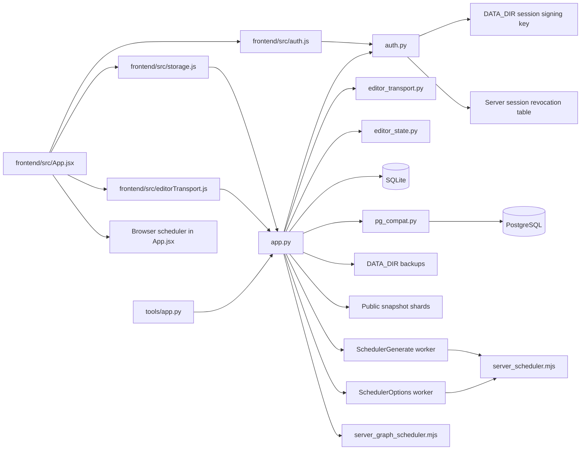
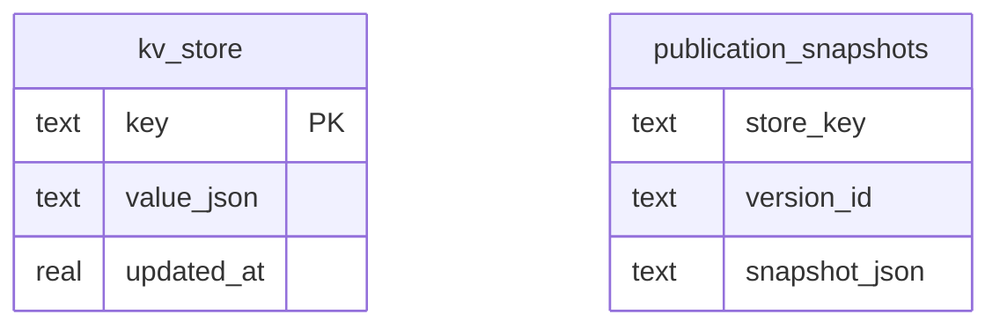
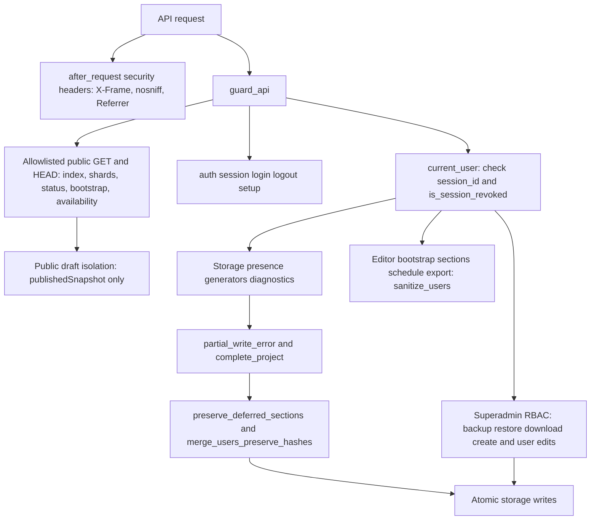
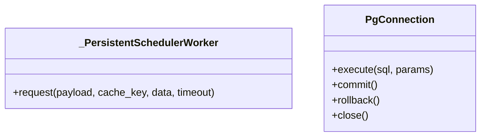
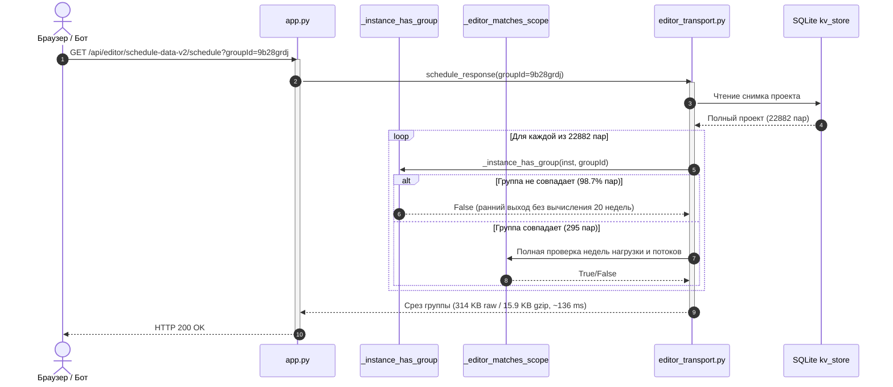
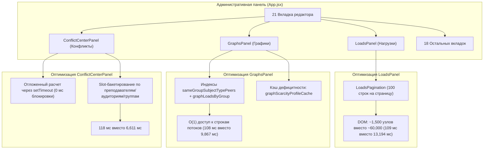

# UML проекта timetable22

Обновлено: 2026-11-06 — разделение 50+ МБ проекта на легкий bootstrap, частичную загрузку разделов, потоковый экспорт, изоляцию планировщиков и строгий аудит бизнес-логики.

## Компоненты

## Хранение

Рабочий проект и пользователи находятся внутри JSON `schedule-data-v2`.
Точные дополнительные поля и индексы определяются инициализацией в `app.py`.
SQLite и PostgreSQL используют совместимый слой `pg_compat.py`.

## API и контроль доступа

| Маршрут | Назначение |
| --- | --- |
| GET /api/auth/session | Состояние входа без списка пользователей |
| POST /api/auth/login | Серверная проверка пароля |
| POST /api/auth/logout | Удаление cookie входа |
| POST /api/auth/setup | Первый администратор по AUTH_SETUP_TOKEN |
| POST /api/auth/password | Смена собственного пароля |
| GET /api/public-* | Опубликованные данные по явному списку |
| GET /api/editor/\<key\>?section=bootstrap | Быстрый bootstrap (~71 КБ gzip) без тяжёлых разделов |
| GET /api/editor/\<key\>?section=\<s\>&token=\<t\> | Посекционная загрузка (loads, schedule, graphState и др.) |
| GET /api/editor/\<key\>/schedule?groupId=\<id\>&week=\<w\> | Рабочие occurrences конкретной группы/недели |
| GET /api/editor/\<key\>/export | Потоковая выгрузка полного переносимого проекта |
| /api/storage* | Закрытый редакторский контур (защита от неполной перезаписи) |
| /api/schedule/*, /api/graphs/* | Закрытые серверные планировщики |

Сессия подписана постоянным ключом. Пароль и роль сверяются с хранилищем на
каждом закрытом запросе. Клиентский ID пользователя не даёт полномочий.

## Классы

## Производительность и шардирование хранилища

### Точки выдачи и оптимизация Scope Matching

| Эндпоинт | Raw Size | Gzip Size | Экономия сжатия | Latency (avg) |
| --- | --- | --- | --- | --- |
| `/api/storage/schedule-data-v2?full=1` | 56160.2 KB | 2916.5 KB | 94.8% | 349.6 ms |
| `/api/editor/schedule-data-v2?section=bootstrap` | 659.8 KB | 68.6 KB | 89.6% | 19.0 ms |
| `/api/editor/schedule-data-v2/schedule?groupId=9b28grdj` | 314.2 KB | 15.9 KB | 94.9% | 136.6 ms |
| `/api/editor/schedule-data-v2/schedule?groupId=9b28grdj&week=1` | 19.7 KB | 2.2 KB | 88.6% | 44.9 ms |
| `/api/editor/schedule-data-v2?section=loads` | 1651.0 KB | 87.3 KB | 94.7% | 24.9 ms |
| `/api/editor/schedule-data-v2?section=graphState` | 1003.2 KB | 61.1 KB | 93.9% | 21.0 ms |
| `/api/public-index` | 201.4 KB | 21.9 KB | 89.1% | 1.5 ms |
| `/api/public-schedule/group/9b28grdj` | 361.5 KB | 19.8 KB | 94.5% | 5.0 ms |

### Гранулярная гидратация вкладок и оптимизация рендеринга (Client-Side Performance)

#### Замеры скорости переключения вкладок (E2E Benchmark, 21 вкладка, проект 57.5 МБ)

| Вкладка | Время до оптимизации | Время после оптимизации | Ускорение |
| --- | --- | --- | --- |
| **Нагрузки** (3,995 строк) | **13 194 мс** | **109 мс** | **121x** |
| **Графики** (расчёт 20 недель) | **9 867 мс** | **108 мс** | **91x** |
| **Центр конфликтов** (O(N²) -> O(N)) | **6 611 мс** | **118 мс** | **56x** |
| Расписание | 2 051 мс | 108 мс | 19x |
| Фактические часы | ~1 800 мс | 298 мс | 6x |
| Списки / Учебный план / Замены / etc. | 500–800 мс | 105–236 мс | 3–5x |

14 из 21 вкладок панели администратора (`lists`, `constraints`, `announcements`, `consultations`, `curriculum`, `substitutions`, `scenarios`, `attestation`, `practices`, `history`, `versions`, `config`, `users`, `semester`) являются легковесными и отображаются мгновенно (0 мс) из уже полученного `bootstrap` без фоновых запросов к сети. Тяжёлые разделы (`loads`, `graphState`, `schedule`) запрашиваются инкрементально только при переходе на соответствующие специализированные вкладки, исключая повторную загрузку уже имеющихся в памяти данных.

Устаревшие архивные копии (`tools/frontend/`, дубликаты планировщиков и временные отчёты) удалены из кодовой базы для поддержания чистоты репозитория.
