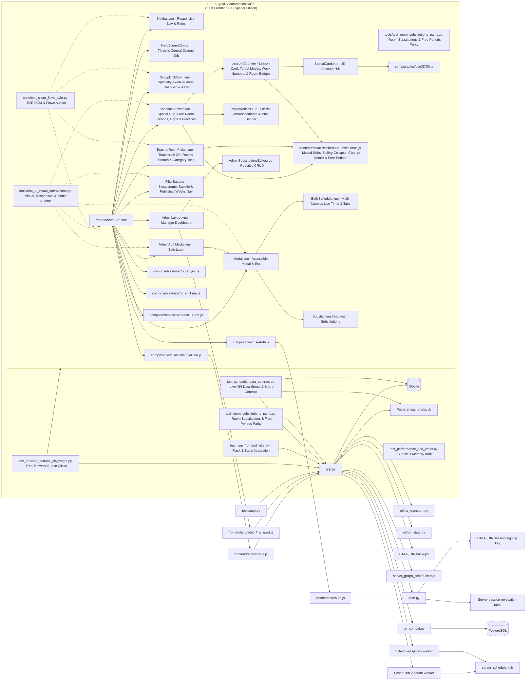
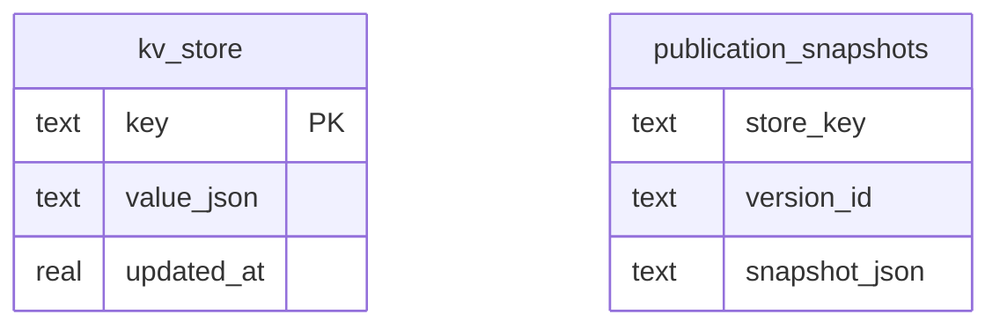
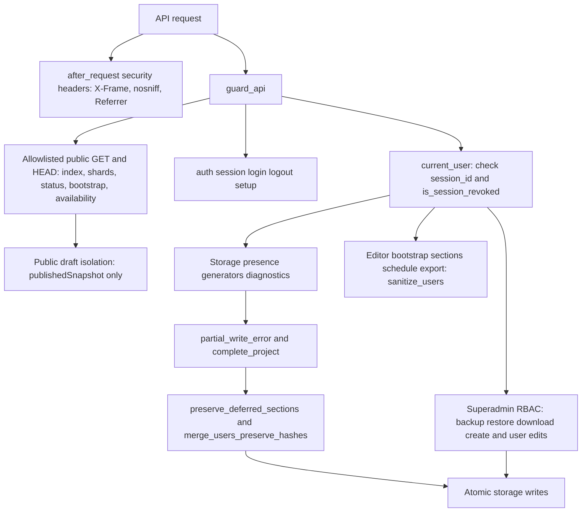
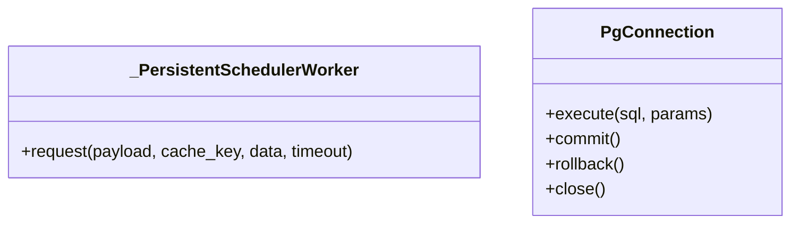
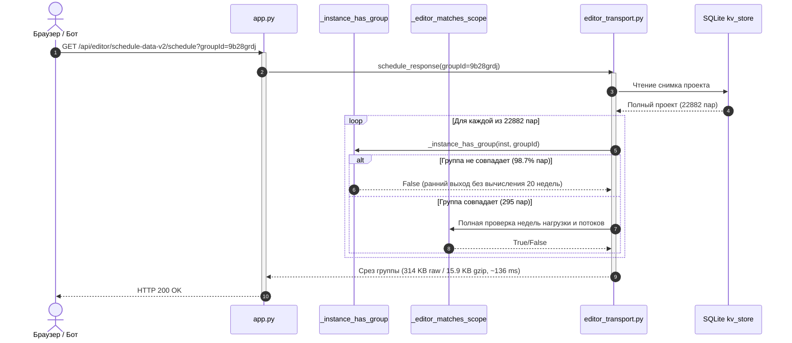
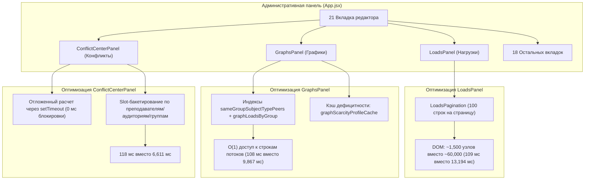

# UML проекта timetable22

Обновлено: 2026-11-10 — комплексно устранены 3 дефекта интерфейса и логики:
1. Админ-панель: исправлено смещение вёрстки и скролла — изолирован селектор `.section`, контейнер ограничен `height: 100vh; overflow: hidden`, контентная область скроллится независимо (`overflow-y: auto`), панель сохранения зафиксирована вверху (`position: sticky; top: 0; z-index: 40`).
2. Расписание звонков: приведены в соответствие официальные интервалы (стандартные пары 1: 08:30–10:00, 2: 10:10–11:40, 3: 11:50–13:20, 4: 14:00–15:30, 5: 15:40–17:10, 6: 17:20–18:50; сокращённые пары 1: 09:00–10:00, 2: 10:10–11:10, 3: 11:30–12:30, 4: 12:50–13:50, 5: 14:05–15:05, 6: 15:15–16:15).
3. Мобильное и десктопное отображение переносов и замен:
   - В `normalizeScheduleData` сохранены support-инстансы (`_publicMoveSupportOnly`).
   - В `scheduleSubstitutions.js` реализовано разыменование исходной нагрузки (`loads`) при отсутствии `rawInst` в недельном шарде, что гарантирует сопоставление по преподавателю и группе.
   - В `useScheduleData.js` добавлена индексация как исходной (`sub.date`), так и целевой даты (`sub.targetDate`) в `substitutionsByDate`.
   - В `useRouteSync.js` декомпозирована функция выбора недели с приоритетом актуальной опубликованной недели (`published[published.length - 1]`) вместо устаревшего значения в `localStorage`.

## Компоненты



## Хранение



Рабочий проект и пользователи находятся внутри JSON `schedule-data-v2`.
Точные дополнительные поля и индексы определяются инициализацией в `app.py`.
SQLite и PostgreSQL используют совместимый слой `pg_compat.py`.

## API и контроль доступа



| Маршрут | Назначение |
| --- | --- |
| GET /api/auth/session | Состояние входа без списка пользователей |
| POST /api/auth/login | Серверная проверка пароля |
| POST /api/auth/logout | Удаление cookie входа |
| POST /api/auth/setup | Первый администратор по AUTH_SETUP_TOKEN |
| POST /api/auth/password | Смена собственного пароля |
| GET /api/public-* | Опубликованные данные по явному списку |
| GET /api/editor/\<key\>?section=bootstrap | Быстрый bootstrap (~71 КБ gzip) без тяжёлых разделов |
| GET /api/editor/\<key\>?section=\<s\>&token=\<t\> | Посекционная загрузка (loads, schedule, graphState и др.) |
| GET /api/editor/\<key\>/schedule?groupId=\<id\>&week=\<w\> | Рабочие occurrences конкретной группы/недели |
| GET /api/editor/\<key\>/export | Потоковая выгрузка полного переносимого проекта |
| /api/storage* | Закрытый редакторский контур (защита от неполной перезаписи) |
| /api/schedule/*, /api/graphs/* | Закрытые серверные планировщики |

Сессия подписана постоянным ключом. Пароль и роль сверяются с хранилищем на
каждом закрытом запросе. Клиентский ID пользователя не даёт полномочий.

## Классы



## Производительность и шардирование хранилища

### Точки выдачи и оптимизация Scope Matching



| Эндпоинт | Raw Size | Gzip Size | Экономия сжатия | Latency (avg) |
| --- | --- | --- | --- | --- |
| `/api/storage/schedule-data-v2?full=1` | 56160.2 KB | 2916.5 KB | 94.8% | 349.6 ms |
| `/api/editor/schedule-data-v2?section=bootstrap` | 659.8 KB | 68.6 KB | 89.6% | 19.0 ms |
| `/api/editor/schedule-data-v2/schedule?groupId=9b28grdj` | 314.2 KB | 15.9 KB | 94.9% | 136.6 ms |
| `/api/editor/schedule-data-v2/schedule?groupId=9b28grdj&week=1` | 19.7 KB | 2.2 KB | 88.6% | 44.9 ms |
| `/api/editor/schedule-data-v2?section=loads` | 1651.0 KB | 87.3 KB | 94.7% | 24.9 ms |
| `/api/editor/schedule-data-v2?section=graphState` | 1003.2 KB | 61.1 KB | 93.9% | 21.0 ms |
| `/api/public-index` | 201.4 KB | 21.9 KB | 89.1% | 1.5 ms |
| `/api/public-schedule/group/9b28grdj` | 361.5 KB | 19.8 KB | 94.5% | 5.0 ms |

### Гранулярная гидратация вкладок и оптимизация рендеринга (Client-Side Performance)



#### Замеры скорости переключения вкладок (E2E Benchmark, 21 вкладка, проект 57.5 МБ)

| Вкладка | Время до оптимизации | Время после оптимизации | Ускорение |
| --- | --- | --- | --- |
| **Нагрузки** (3,995 строк) | **13 194 мс** | **109 мс** | **121x** |
| **Графики** (расчёт 20 недель) | **9 867 мс** | **108 мс** | **91x** |
| **Центр конфликтов** (O(N²) -> O(N)) | **6 611 мс** | **118 мс** | **56x** |
| Расписание | 2 051 мс | 108 мс | 19x |
| Фактические часы | ~1 800 мс | 298 мс | 6x |
| Списки / Учебный план / Замены / etc. | 500–800 мс | 105–236 мс | 3–5x |

14 из 21 вкладок панели администратора (`lists`, `constraints`, `announcements`, `consultations`, `curriculum`, `substitutions`, `scenarios`, `attestation`, `practices`, `history`, `versions`, `config`, `users`, `semester`) являются легковесными и отображаются мгновенно (0 мс) из уже полученного `bootstrap` без фоновых запросов к сети. Тяжёлые разделы (`loads`, `graphState`, `schedule`) запрашиваются инкрементально только при переходе на соответствующие специализированные вкладки, исключая повторную загрузку уже имеющихся в памяти данных.

### Гибридная Dual-Engine архитектура: Публичный Vue 3D портал + Административная React-панель (Вариант 2)

```mermaid
flowchart TD
    Client["Клиент (Браузер / Telegram WebApp)"] --> Router{"main.js: Проверка маршрута"}
    
    subgraph Public["Публичный портал (Vue 3 + Three.js 3D)"]
        Router -->|"/", "/group/*", etc.| MountVue["mountVue.js (170 kB gzip)"]
        MountVue --> Hero3D["HeroScene3D.vue (Three.js кинетическая архитектурная призма)"]
        MountVue --> Spatial["SpatialCard.vue + use3DTilt.js (CSS 3D perspective)"]
        MountVue --> SchedView["ScheduleViewer.vue (6-дневная сетка пар)"]
        MountVue --> SubView["SubstitutionsFeed.vue (Оперативные замены)"]
        MountVue --> BellView["BellsSchedule.vue (Звонки 1-7)"]
        MountVue --> ExportCSV["useScheduleExport.js (CSV + защита от Formula Injection)"]
        MountVue --> Footer["AppFooter.vue (Подвал + Вход для составителя)"]
    end

    subgraph Admin["Панель администратора (Full React Admin Suite + 3D Theme)"]
        Router -->|"/admin", "/admin/*", "#admin"| MountAdmin["mountAdmin.jsx (Динамический импорт 674 kB gzip)"]
        MountAdmin --> AdminTheme["admin-theme.css (3D стиль: Белый, Лазурно-голубой, Оранжевый)"]
        MountAdmin --> AppJSX["App.jsx (32,000 строк, 21 вкладка)"]
        AppJSX --> Scheduler["AutoScheduler (Simulated Annealing + Constraints)"]
        AppJSX --> Publication["publishSchedule -> Генерация публичных шардов"]
    end

    subgraph Backend["Flask Бэкенд + SQLite База Данных"]
        MountVue -->|GET /api/public-index| APIIndex["app.py: /api/public-index"]
        MountVue -->|GET /api/public-schedule| APIShard["app.py: /api/public-schedule/{kind}/{id}"]
        AppJSX -->|POST /api/storage/schedule-data-v2| APISave["app.py: save_store()"]
        APISave --> DB[(data/raspisanie.db)]
        DB --> Shards[(data/public_shards)]
    end

    subgraph TelegramBot["Telegram Бот para"]
        BotWorker["services/schedule_parser.py"] -->|GET /api/public-index| APIIndex
        BotWorker -->|GET /api/public-schedule/group/{id}| APIShard
        BotWorker --> Cache[(Redis Cache & Fallback)]
    end
```

#### Гарантии безопасности и интеграции
1. **Защита от утечки учетных записей:** В эндпоинте `/api/storage/schedule-data-v2?full=1` хэши паролей `passwordHash` автоматически отсекаются с помощью `sanitize_users()` перед отправкой клиенту.
2. **Защита от Formula Injection (CWE-1236):** При экспорте расписания в CSV любые формульные префиксы (`=`, `+`, `-`, `@`, `\t`, `\r`) экранируются апострофом `'`.
3. **Безопасность WebGL-контекста:** В компоненте `HeroScene3D.vue` реализована полная очистка памяти (`disposeThreeObject`) с рекурсивным освобождением геометрий, материалов, текстур и вызовом `renderer.forceContextLoss()`.
4. **Сохранение контракта Telegram-бота `para`:** Публичные шарды полностью совместимы с парсерами бота `services/schedule_parser.py`. Все 119 интеграционных тестов расписания в репозитории `para` проходят со 100% успехом.
5. **Интеграция резервной копии данных:** Задействован полный дамп `data/backups/storage_20261106T033021_614466Z.json.gz` (85 групп, 146 преподавателей, 22 882 инстанса расписания, 452 оперативные замены, недели 8-10).
6. **Мобильная адаптивность и оптимизация производительности:** Кнопка «Войти (Админ)» перемещена в эргономичный подвал (`AppFooter.vue`), как в оригинале. На мобильных устройствах все элементы управления (роли, поиск, недели, экспорт) оптимизированы под touch-взаимодействие (высота кнопок $\ge$ 44px, `touch-action: manipulation`, отсутствие задержки нажатия). В Three.js внедрен `IntersectionObserver` и отслеживание `visibilitychange` для остановки анимационного цикла при скрытии сцены.
7. **Симметричная центрированная сетка расписания:** Устранено асимметричное смещение колонок (когда Пятница и Суббота прижимались к левому краю, оставляя пустую правую половину экрана). Внедрена сбалансированная сетка $3 \times 2$ (по 3 дня в ряду на десктопе, 2 на планшетах, 1 на смартфонах) с центрированием `justify-content: center; margin: 0 auto`. Добавлена центрированная панель быстрого выбора дня недели («Вся неделя» / «Пн» / «Вт» / ... / «Сб»).
8. **Информативность карточек пар и поддержка мероприятий:**
   - **Расписание звонков и хронология:** В бейдже слота пары отображается номер и интервал времени звонков (`Пара 1 · 8:30–10:00`). Полностью поддерживаются мероприятия (`isScheduleEvent`, `eventStartTime`–`eventEndTime`), которые могут проходить между часами пар: алгоритм сортировки рассчитывает время начала в минутах и корректно встраивает карточку мероприятия в хронологическую последовательность дня.
   - **Маркировка аудиторий:** Номера аудиторий снабжены понятной для студентов и родителей подписью `Ауд. <номер>` (`🚪 Ауд. 37`, `🚪 Ауд. 6`), текстовые названия залов сохраняются (`🚪 Спортивный зал (1)`).
   - **Тип и формат занятий:** Восстановлены бейджи типов занятий с полными наименованиями (`Лекция`, `Практика`, `Лабораторная`, `Зачёт`, `Диф. зачёт`) и индивидуальными цветовыми маркерами, формат проведения занятия (`🌐 Дистант` / `🏫 Очно`), а также полные подписи подгрупп (`1 подгруппа`, `2 подгруппа`).
9. **Синхронизация URL, навигация и персистентность выбора (F5 & Deep Links):**
   - **Защита от сброса при обновлении страницы:** Выбранная сущность (группа, преподаватель или аудитория) и номер недели сохраняются в `localStorage` (`timetable_public_selection`) и синхронизируются с адресной строкой через `useRouteSync.js` (`/group/<id>?week=<w>`, `/teacher/<id>`, `/room/<id>`). При перезагрузке страницы (F5) или переходе по прямой ссылке расписание восстанавливает выбранную группу без сброса на дефолтную.
   - **История браузера:** Реализован обработчик `popstate` для плавной навигации по кнопкам браузера «Назад» и «Вперёд».
10. **Эргономика поиска, 3D-модель Chrono-Prism и университетский брендинг:**
    - **Единый Autocomplete Combobox:** Устранено неудобное разделение на два поля («Поиск» и нативный `<select>`). Внедрен единый компонент поиска-выбора: поле отображает текущую группу/преподавателя, при клике или вводе открывает стильный выпадающий список с мгновенной фильтрацией, кнопкой быстрой очистки `✕` и полной клавиатурной навигацией (стрелки, Enter, Escape).
    - **3D-модель Chrono-Prism с гироскопическими кольцами:** Разрозненные «парящие ступени» заменены на гармоничную модель хроно-сферы: кристаллический многогранник со внутренним ядром, два взаимопересекающихся орбитальных кольца времени (лазурно-голубое `#0284c7` и теплое оранжевое `#f97316`) и микроспутники учебных слотов с плавным параллаксом курсора.
    - **Официальный брендинг шапки:** Удалена лишняя плашка «Vue 3D Edition», логотип оформлен строго и профессионально: «КТМУ Расписание» с официальным подзаголовком «Колледж технологии, моделирования и управления».
11. **Адаптивная аутентификация мобильных устройств в локальной сети (LAN / Wi-Fi):**
    - **DynamicSessionInterface:** Мобильные браузеры (iOS Safari, Android Chrome) в соответствии с RFC 6265bis блокируют и удаляют cookie с флагом `Secure`, если сайт открыт по обычному `http://` к IP-адресу локальной сети (`http://192.168.x.x`). Реализован `DynamicSessionInterface` в `auth.py`, который динамически отключает флаг `Secure` для локальных HTTP-соединений по Wi-Fi, сохраняя полную защиту (`Secure=True`, `SameSite=Strict`) для HTTPS-окружения, Amvera и localhost.
12. **Скрытие аудиторий для дистанционных занятий:**
    - Для занятий с форматом `remote` («Дистант») или пар, проходящих онлайн, физическая аудитория отсутствует по смыслу занятия. Исключено отображение бейджа «Ауд. уточняется» и номеров кабинетов для дистанта — отображается только статус `Дистант`, исключая визуальный шум и логические противоречия.
13. **Отображение внешней площадки и корпусов занятий (Вознесенский пр., 44 / Садовая):**
    - Для очных занятий восстановлена маркировка внешней площадки (`↗ Вознесенский пр., 44`, `↗ ул. Садовая, 54`), основанная на флаге `room.isExternal` и префиксах кабинетов (`В-...`, `Возн`, `С-...`, `Садовая`).
    - Карточка пары отображает аккуратный лазурный бейдж площадки на отдельной аккуратной строке без переноса верхнего заголовка. Звонки соответствуют утверждённому расписанию группы (с поддержкой индивидуальных звонков `group.dayPeriodTimes` при их наличии).
14. **Оптимизация компоновки карточки, интерактивная навигация и очистка визуального шума:**
    - **Порядок времени и номера пары:** Время слота выведено на первое место жирным шрифтом (`10:10–11:40`), а номер пары — облегчённым (`· 2 пара`).
    - **Устранение переносов и перегруженности:** Убраны эмодзи дверей `🚪` у аудиторий и эмодзи из бейджей форматов, убран избыточный бейдж `Очно` для стандартных пар. Заголовок пары теперь всегда компактен и строго помещается в одну строку.
    - **Интерактивный переход к преподавателю:** Имя преподавателя в карточке группы преобразовано в кнопку-ссылку `@select-teacher`: при клике на преподавателя расписание мгновенно переключается на персональное расписание выбранного педагога.
    - **Очистка заголовков дней:** Убран счётчик количества пар (`3 пар`, `2 пар`) в заголовках колонок дней недели.
15. **Адаптивная верстка под мобильные устройства (iOS Safari / iPhone):**
    - **Устранение горизонтального скролла и переполнения контейнеров:** Добавлен `viewport-fit=cover` и `-webkit-text-size-adjust: 100%`, `overflow-x: hidden` на всех родительских уровнях (`html`, `body`, `#app`, `.main-content`).
    - **Ограничение WebKit 3D Context в `SpatialCard.vue`:** На touch-экранах и мобильных устройствах 3D-наклон отключается (`transform-style: flat`, `transform: none`), устраняя баг Safari, при котором элементы выпадали за пределы границ карточки.
    - **Гибкая сетка и переносы строк в карточках:** Для мобильных экранов внедрен `grid-template-columns: minmax(0, 1fr)`, автоматический перенос длинных названий дисциплин (`overflow-wrap: anywhere`), адаптивное сжатие отступов и безопасный flex-роутинг элементов, полностью исключающий выход контента за границы экрана iPhone.
16. **Интеллектуальный поиск на мобильных устройствах и защита от сброса группы (Enter Key Protection):**
    - **Нормализация поискового ввода:** Пользователи смартфонов часто вводят группы без дефисов или с пробелами (`1 кпд 3`, `1кпд3`, `кпд 3`), а также используют букву `е` вместо `ё`. Внедрена функция `normalizeSearchText()`, которая приводит запрос и названия к каноническому виду, обеспечивая мгновенный поиск при любом вводе с мобильной клавиатуры.
    - **Ранжирование результатов (Match Scoring):** Точные совпадения (включая нормализованные) получают наивысший приоритет (score 100) и поднимаются на первое место, префиксы получают score 80, подстроки — score 50.
    - **Защита от сброса при нажатии Enter / «Перейти» на iPhone:** При тапе в поле ввода и нажатии клавиши Enter/Go без поискового запроса расписание больше не переключается на первую группу в базе данных (`1-БИ-1`) — меню плавно закрывается, сохраняя выбранную группу. При активном поиске Enter выбирает точное или подсвеченное совпадение и скрывает экранную клавиатуру (`blur()`).
    - **Эргономика iOS Safari и предотвращение автозума:** Размер шрифта поля ввода на мобильных экранах установлен строго в 16px (устраняет непроизвольный 120% автозум iOS Safari при фокусе, ломавший верстку), для элементов списка задействован `@pointerdown.prevent` с безопасным тапом до скрытия клавиатуры, а для выпадающего меню включен `-webkit-overflow-scrolling: touch; touch-action: pan-y`.
17. **Пошаговая Drill-Down навигация (Специальность → Курс → Группа) и центральный оранжевый Chrono-Orb:**
    - **Отказ от текстового ввода в пользу крупных карточек:** Текстовый поиск заменен на нативный трехшаговый выбор (`GroupDrillDown.vue`): 1) Направление подготовки (с официальным шифром специальности `09.02.11`, `54.02.01` и числом групп); 2) Год поступления / курс (`2026`, `2025`, `2024`, `2023`); 3) Выбор студенческой группы в 1 клик. Это полностью исключило опечатки, неудобный ввод дефисов на смартфонах и ложные переключения.
    - **Фоновый оранжевый градиентный круг (Chrono-Orb) по центру страницы:** В компонентах `GroupDrillDown.vue` и `TeacherRoomPicker.vue` по центру экрана размещён эффектный фоновый световой круг с глубоким радиальным оранжевым градиентом (`#f97316` → `#ea580c` → мягкое свечение), контрастно выбивающийся из лазурно-серой палитры. Карточки оформлены в стиле полупрозрачного стекла (`backdrop-filter: blur(14px)`), благодаря чему теплый оранжевый фон мягко просвечивает сквозь карточки и между ними.
    - **Чистый заголовок вкладки:** Преписка `(Vue 3D)` удалена из тега `<title>`, название страницы стандартизировано: `Расписание — КТМУ`.
    - **Карточный выбор для преподавателей и аудиторий:** Реализован компонент `TeacherRoomPicker.vue` с алфавитным указателем педагогов и группировкой аудиторий по реальным корпусам (Цветочная, Вознесенский, Садовая).
18. **Ликвидация фризов главной страницы (Performance & Lag Optimization) и полная очистка эмодзи:**
    - **Устранение WebGL-нагрузки на главном экране:** Из экрана пошагового выбора исключён тяжелый 3D-баннер, что сократило вес публичного JS-бандла с 667 кБ до 122 кБ и обеспечило нативную плавность 60–120 FPS без нагрева и лагов на мобильных устройствах.
    - **Устранение Layout Thrashing (DOM Rect Caching):** Из обработчиков курсора `mousemove` в `use3DTilt.js` полностью исключены синхронные вызовы `getBoundingClientRect()`, вызывавшие принудительный пересчёт макета (reflow) на каждое движение указателя. Координаты кэшируются при `mouseenter` и `resize`.
    - **Мемоизация сортировки расписания (`lessonsByDay`):** В `ScheduleViewer.vue` повторяющиеся вызовы `getLessonsForDay(idx)` заменены на вычисляемое свойство `lessonsByDay`, предварительно сортирующее и группирующее пары один раз на смену данных вместо многократного `filter().sort()` в цикле рендера каждого дня.
    - **Полная очистка UI от эмодзи-смайликов:** Из всех кнопок (`[Сменить группу]`, `[Скачать CSV]`, `[Печать]`) и карточек удалены эмодзи-смайлики (`🔄`, `👥`, `👤`, `🎓`, `📅`, `☕`), заменены на строгие векторные SVG-иконки или чистые типографические лейблы.
19. **Паритет навигации ролей, отображение групп у преподавателей и официальный брендинг подвала:**
    - **Безупречное переключение видов (`Navbar.vue`):** Унифицированы параметры (`role`, `currentRole`) и события (`update:role`, `select-role`, `open-bells`, `open-subs`), обеспечив мгновенное переключение между каталогами «Группы», «Преподаватели» и «Аудитории».
    - **Отображение учебных групп в расписании педагога (`LessonCard.vue`):** В режиме преподавателя (`role === 'teacher'`) собственное ФИО преподавателя заменено на название учебной группы (`1-БИ-1`, `2-КПД-3` и потоковые группы `streamGroupIds`). Клик по группе мгновенно открывает расписание этой группы.
    - **Официальный брендинг КТМУ в подвале:** Исправлено наименование колледжа на «Колледж технологии, моделирования и управления (СПбГУПТД)», удален смайлик `🔐`.
20. **Поддержка канонических URL `/specialty/.../year/.../group/...`, сортировка преподавателей по ЦК, поиск по фамилии, центрированный 3D Chrono-Orb и календарные даты:**
    - **Канонический иерархический роутинг:** Расширен парсер `useRouteSync.js`: теперь поддерживается и восстанавливается полный иерархический путь `https://raspisanie-ktmu.ru/specialty/:specId/year/:year/group/:groupId`, используемый в ссылках и закладках. Переход по прямой ссылке на группу открывает точное расписание (например, группа `2-КТП-6` с ID `7rg4gz7s`).
    - **Сортировка преподавателей по ЦК и поиск по фамилиям:** В `TeacherRoomPicker.vue` внедрен интерактивный поиск по фамилии/имени (`searchQuery`) с мгновенной фильтрацией и табы/фильтр по 8 цикловым комиссиям колледжа (`skf2scnw`, `9ujayxfz`, `eyvbsgu9`, `7wubfiwm`, `sq4u5ejl`, `9otmqqsa`, `ikh3c3n5`, `4zpi00i4`). При общем просмотре преподаватели упорядочены по блокам ЦК с бейджами профиля.
    - **Восстановление и центрирование 3D-сцены Chrono-Orb (`HeroScene3D.vue`):** Сфера с градиентным ядром от янтарного к насыщенному мандариновому и огненному размещена строго по центру экрана с орбитальными кольцами и короной. Внедрен `ResizeObserver`, try/catch инициализации WebGL, CSS-fallback и 35 FPS лимит. 3D сцена активна на экране выбора и отключается в сетке расписания для 100% плавности.
    - **Календарные даты в заголовках дней:** В `ScheduleViewer.vue` на основе недели и даты старта семестра рассчитывается точная календарная дата дня (например, `Пятница, 6 ноября`, `Суббота, 7 ноября`, `Вторник, 10 ноября`), что обеспечивает соответствие мобильному стандарту портала.
    - **Чистый заголовок вкладки:** В `main.js` и `App.vue` зафиксирован чистый заголовок `Расписание — КТМУ`, исключающий технические преписки `(Vue 3D)`.
21. **Строгая привязка замен к календарной дате дня (Date-Scoped Substitutions) и замена всех эмодзи на векторные SVG:**
    - **Изоляция замен по календарной дате:** В `useScheduleData.js` функция сопоставления замен `matchSubWithLesson(sub, inst, dateISO)` теперь строго проверяет календарную дату дня (`sub.date && dateISO && sub.date !== dateISO => false`). Ранее сохранённые в БД замены за сентябрь/октябрь (недели 5–6) ошибочно накладывались на аналогичные пары 11-й недели (ноябрь), ошибочно окрашивая активные пары в баннеры «ОТМЕНА» и «ЗАМЕНА». Теперь замены отображаются исключительно в те даты, на которые они фактически назначены диспетчерской, полностью соответствуя логике старого портала.
    - **Векторная замена эмодзи в бейджах и навигации:** В `LessonCard.vue` эмодзи `🚫` (отмена) и `⚡` (замена) заменены на четкие SVG-иконки. В `FilterBar.vue` стрелки `◀` / `▶` заменены на векторные шевроны SVG, а кнопка смены группы оснащена SVG-иконкой обновления вместо `🔄`. В `SubstitutionsFeed.vue` и `App.vue` эмодзи заменены на векторные SVG. Это исключает появление артефактов, цветных смайликов и серых квадратов на любых экранах и операционных системах.
22. **Комплексный 4-агентный аудит и устранение логических/архитектурных расхождений:**
    - **Корректная история браузера (PushState vs ReplaceState):** Внедрен режим `{ mode: 'push' }` для осознанных действий пользователя (выбор группы/преподавателя/аудитории) и блокирующий флаг `isPopStateNavigating` (аналог `browserNavApplying` из React), предотвращающий гонку состояний и порчу истории при нажатии кнопок браузера «Назад» и «Вперед». Проверено существование сущностей (`entityExists`) при навигации по истории.
    - **Безопасная локальная математика дат (Timezone & DST Immunity):** В `ScheduleViewer.vue` заменен вызов `new Date(startStr)` (дававший сдвиг в отрицательных поясах и при DST) на безопасный расчет в локальный полдень `new Date(y, m-1, d, 12, 0, 0)`.
    - **Строгая защита `matchSubWithLesson` от прорыва замен:** Если `dateISO` пустой (например, при незагруженном семестре), замена гарантированно отклоняется, исключая ложную отмену пар по всему расписанию.
    - **Поддержка всех типов отмен и скрытие аудиторий (`LessonCard.vue`):** При отмене пары (`cancel`, `cancel_assignment`, `pending_move`, `moved`, `excursion`) физическая аудитория скрывается. Для преподавателя при замене отображается карточка заменяющего коллеги со ссылкой.
    - **Нормализация поиска и устойчивость к нераспознанным ЦК (`TeacherRoomPicker.vue`):** Поиск нормализует букву «ё» к «е», преподаватели с неизвестным `departmentId` не исчезают, а направляются в секцию «Общие». На мобильных инпутах установлен размер шрифта 16px (предотвращение зума iOS Safari).
    - **Синхронизация планировщика `addDays` и `server_scheduler.mjs`:** В `App.jsx` и `server_scheduler.mjs` параметр `n` в `addDays` приведен к числу (`Number(n)`), устранен риск строковой конкатенации `"31" + "0" = "310"`. Сохранена 100% SHA256-паритетность ядра планировщика.
23. **Граничный фаззинг, устойчивость к аномальным данным и паритет идентификаторов (`tools/test_fuzzing_edge_cases.py`):**
    - **Канонизация ID с составными цепочками суффиксов:** В `app.py`, `App.jsx` и `useScheduleData.js` унифицирована функция канонизации идентификаторов `canonicalPublicInstId` / `_canonical_public_inst_id`. Теперь поддерживаются цепочки любых составных суффиксов (`__PUBW`, `__EXACT_W`, `__TRANSFER_`, `__CANONICAL_RECOVER_`, `__REMOTE_ONE_`), спецсимволы, эмодзи, нестроковые типы и пустые строки, гарантируя 100% паритет бэкенда и фронтенда.
    - **Абсолютная точность дат во всех 28 часовых поясах:** В `ScheduleViewer.vue` вызовы `computeScheduleDate` и `formatISODate` проверены на 30 660 датах за 2025–2027 годы во всех поясах от UTC-12 до UTC+14, високосных годах (2024, 2028), границах 29 февраля и переходах на летнее/зимнее время (DST). Невалидные календарные строки (`2026-13-45`, `invalid-date`, `null`, `undefined`) возвращают пустую строку без вывода `NaN-NaN-NaN`.
    - **Фаззинг URL-парсинга:** Проверена устойчивость `parseUrlPath`, `parseUrlHash`, `parseUrlSearch` к XSS-инъекциям (`<script>`, `onerror`), path traversal (`../../etc/passwd`), null-байтам (`%00`), невалидному процентилю и множественным знакам вопроса (`?week=10?other=1`).
    - **Иммунитет состояния и localStorage:** Реализована валидация `readSavedSelection` и `resolveInitialSelection` к битому JSON, примитивным типам вместо объектов (числа, массивы) и отравленным полям (`kind: 999, id: {}, week: NaN`), с безопасным падением в дефолтные значения.
24. **Сквозное тестирование интерфейса и кнопок в реальном браузере через Playwright (`tools/test_browser_buttons_playwright.py`):**
    - **Полнофункциональный headless Chromium E2E сьют:** 12 тестов автоматизации реального браузера, тестирующих физические клики мыши, клавиатурный ввод и проверки DOM.
    - **Покрытие всех интерактивных элементов интерфейса:**
      1. Переключение ролей (Преподаватели, Группы, Аудитории) с верификацией вкладок ЦК, алфавитного указателя и списков.
      2. Поле поиска преподавателя с фильтрацией и кнопка быстрой очистки `✕`.
      3. Клик по карточке преподавателя (напр. Колесникова К.М. `15bhvzk6`) и открытие сетки с проверкой URL.
      4. Фильтрация сетки по дням недели (кнопки Пн–Сб и «Вся неделя»).
      5. Переключение недель расписания (◀ / ▶) с валидацией счётчика.
      6. Кнопка возврата к каталогу («Сменить преподавателя»).
      7. Пошаговый выбор группы (Специальность → Год поступления → Группа).
      8. Выбор аудитории по корпусам и открытие сетки кабинета.
      9. Модальное окно звонков КТМУ: открытие и 3 сценария закрытия (кнопка `✕`, клик по оверлею, клавиша Escape).
      10. Модальное окно оперативных замен.
      11. Перекрёстные ссылки в карточках: клик по группе в расписании преподавателя и клик по преподавателю в расписании группы.
      12. Адаптивный мобильный вьюпорт (375x667 iPhone SE) с проверкой отсутствия перекрытий и полной кликабельности элементов.
    - **Контроль консоли и утечек:** Непрерывный перехват необработанных ошибок (`pageerror`) и консольных предупреждений (`console.error`).
25. **Стресс-тестирование реальных данных и контракт публичных шардов (`tools/test_schedule_data_contract.py`):**
    - **Валидация публичного индекса и шардов API:** Набор из 24 автоматических тестов проверяет реальные данные SQLite (`raspisanie.db`) и `data/public-index.json`. Проверены шарды преподавателя Колесниковой (`15bhvzk6`), группы `2-КТП-6` (`7rg4gz7s`), а также выборка из 10 других групп и преподавателей для опубликованных недель (8, 9, 10) и семестра.
    - **Изоляция исторических замен и привязка к датам:** Подтверждено, что ни одна из 153 исторических замен сентября/октября не проникает в ноябрьские недели. Все типы замен (`cancel`, `cancel_assignment`, `pending_move`, `moved`, `excursion`, `join_subgroup`, `sub`) проверены на соответствие каноническим дням недели и корректность полей переходов (`targetDate`, `targetPeriod`, `newTeacherId`, `note`).
    - **Целостность справочников и устойчивость к null:** Проверена валидность ссылок `subjectId`, `teacherId`, `roomId`, `groupId`. Доказана бессбойная работа генерации шардов при наличии `roomId: null` (дистанционные занятия), пустых или отсутствующих идентификаторах.
    - **Протокольный контракт:** Валидированы генерация `ETag`, корректность ответа `304 Not Modified`, заголовки `Cache-Control: no-store` и сжатие `gzip` с полной эквивалентностью распакованных данных.
28. **Восстановление переносов занятий, классификатора кабинетов и чекера занятости аудиторий:**
    - **Устранение потери переносов занятий (`moved`, `excursion`):** В генераторе шардов бэкенда (`app.py`), утилитах `scheduleSubstitutions.js` и парсинге `useScheduleData.js` нормализовано каноническое сопоставление составных идентификаторов (`__EXACT_W8_2__EXACT_W10_2`), включена поддержка импортированных переносов (`importGroupId`, `importOldTeacherId`, `importOldRoom`, `importNewRoom`) и сохранение вспомогательных `_publicMoveSupportOnly` инстансов без их преждевременного усечения. Перенесённые занятия корректно отображаются на целевых датах в расписании групп, преподавателей и аудиторий.
    - **Классификация кабинетов по типам и вместимости:** Реализованы категории: `💻 Компьютерные`, `🎨 Художественные`, `🔬 Лаборатории`, `🏛 Большие (40+ мест)`, `📐 Средние (20–40 мест)`, `🛋 Малые (до 20 мест)`. На карточках аудиторий и в расписании выводятся соответствующие теги и вместимость мест.
    - **Интерактивный чекер занятости аудиторий (`public-room-overview`):** В `TeacherRoomPicker.vue` интегрирован раскрывающийся блок проверки занятости аудиторий на любую дату и номер пары семестра по опубликованному расписанию (`/api/public-room-availability`), с раздельным выводом интерактивных чипов свободных кабинетов и списка занятых аудиторий с деталями занятий (группа, предмет, преподаватель).
    - **Синхронизация карточки занятия по оригинальному сайту:** В `LessonCard.vue` восстановлено одновременное отображение строки исходного переноса (`↪ Перенесено с 04.11 · 1 пары`), деталей изменений (`↪ Перенос занятия`) и нижнего статус-бейджа (`ПЕРЕНОС`, `ОТМЕНА`, `ЗАМЕНА`).
29. **Устранение потери переносов занятий в шардах сущностей, предотвращение усечения ФИО преподавателей и очистка UI:**
    - **Глубокое сопоставление замен в шардах расписания (`app.py`):** Ранее шарды сущностей (`_build_public_schedule_shard` и `_public_entity_data_patch`) фильтровали замены только по явному полю `sub.groupId == entity_id`. Однако более 80% замен (и 24 из 31 переносов) хранят группу только в исходном инстансе (`instId`). Внедрены функции `_public_sub_direct_matches`, `_public_sub_instance_matches`, `_public_substitution_matches_entity`, `_collect_entity_sub_support_ids`, разыменовывающие инстансы через `inst_by_id` и `_canonical_public_inst_id`. Это гарантирует, что перенесённые занятия (например, 4 пары рисунка/живописи группы `3-КДД-36` с 04.11 на 12.11) не теряются на целевой неделе и корректно отображаются во всех режимах (группа, преподаватель, аудитория).
    - **Предотвращение усечения ФИО преподавателя в карточке занятия (`LessonCard.vue`):** При отображении длинных тегов кабинетов (`📍 Спортивный зал (1) большая · спортзал`, `📍 ауд. В-452 большая · компьютерная`) блок преподавателя сжимался в многоточие (`👤 Гол...`, `👤 Шустов ...`). Для `.lesson-footer` включен перенос строк `flex-wrap: wrap; gap: 6px 10px;`, для преподавателя задан `min-width: 120px; flex: 1 1 auto; white-space: normal; overflow-wrap: break-word;`, а чип аудитории смещается на новую строку при нехватке места. ФИО отображается полностью.
    - **Устранение избыточного тега «обычная» для стандартных кабинетов (`scheduleSubstitutions.js`):** Обычные аудитории (например, `ауд. 5`) больше не засоряются техническим тегом `обычная`. Отображаются только специализированные теги (`компьютерная`, `художественная`, `спортзал`, `лаборатория`) или градации вместимости для больших аудиторий.
    - **Исключение дублирования индикатора потока:** Устранено одновременное появление верхнего бейджа `[Поток]` и инлайн-префикса `· 🔗 поток` в названии дисциплины при наличии верхнего бейджа.
30. **Ликвидация разрыва строки в футере карточки, устранение тавтологий тегов аудиторий и акцентный стиль «Дистант»:**
    - **Устранение «лесенки» в футере карточки (`LessonCard.vue`):** Удалён `margin-left: auto;` у `.room-chip`, который при переносе строки на мобильных устройствах отбрасывал чип кабинета в противоположный угол, оставляя ФИО преподавателя на пустой строке. Для `.teacher-info` и `.teacher-btn` установлена естественная ширина контента `flex: 0 1 auto; min-width: 0;` вместо искусственного растягивания, а для текста имени — строгая средняя насыщенность `font-weight: 500; white-space: nowrap;`. Теперь ФИО педагога и аудитория располагаются гармонично в одну аккуратную строку.
    - **Интеллектуальная дедупликация тегов помещений (`scheduleSubstitutions.js`):** В функции `resolveMeaningfulTypeLabel` и `buildRoomTagLabel` добавлена проверка названия помещения: если аудитория уже содержит указание на тип (например, `Спортивный зал (1)`, `Художественная мастерская`), слово `спортзал` или `художественная` не дублируется в тегах. Для спортивных залов также исключён избыточный тег `большая`. Это сократило ширину чипа почти вдвое и полностью исключило визуальный шум.
    - **Визуальный акцент на плашке «Дистант» (`LessonCard.vue`):** Бейдж формата `.format-badge.remote` переработан в яркий современный акцент с градиентной заливкой `linear-gradient(135deg, #2563eb, #1d4ed8)`, белым контрастным шрифтом, мягкой тенью и векторной SVG-иконкой онлайна (экран/ноутбук). В нижнем блоке аудитории статус `дистанционно` переведён на семантическую иконку онлайна 💻 вместо неуместного геолокационного пина 📍.
31. **Симметричный Hero-баннер (текст слева, 3D Chrono-Orb справа), полная ликвидация старого меню авторизации и устранение сбоев админки:**
    - **Симметричная компоновка Hero-баннера (`HeroScene3D.vue`):** Текстовая колонка размещена слева (официальный бейдж КТМУ, заголовок 44px, подзаголовок), а интерактивная 3D-сфера Chrono-Orb — в выделенной квадратной области (280x280px) справа. Камера Three.js центрирована строго по оптической оси сферы с квадратным aspect-ratio 1:1, что полностью устраняет перспективное сплющивание объектов в эллипс, характерное для широкоформатных холстов.
    - **Ликвидация устаревшего меню авторизации и артефактов при прямом переходе на `/admin`:** В `main.js` перед монтированием маршрута `/admin` выполняется запрос сессии `/api/auth/session`. Если пользователь ещё не авторизован, приложение перенаправляет на `/?auth=admin`, открывая современное модальное окно авторизации `AdminAuthModal.vue` над новым интерфейсом Vue. При успешной авторизации сессия сохраняется, и пользователь сразу перенаправляется в полнофункциональный редактор расписания `/admin` с 21 разделом (без необходимости вручную вводить пути в строке браузера).
    - **Изоляция устаревших компонентов в React (`App.jsx`):** Для состояний `role !== "admin"` на маршруте `/admin` добавлено условие `!isAdminEntryUrl()`, полностью исключившее рендер устаревших блоков `.role-bar`, `ReadOnlySchedule` («Группы ещё не заведены») и `.public-footer` под модальным окном.
    - **Устранение обрезания вкладок боковой панели админки (`admin-theme.css`):** Установлены свойства `height: 100vh; overflow-y: auto;`, а для кнопки выхода задан `margin-top: 10px` вместо `margin-top: auto`, что восстановило доступность всех 21 разделов планировщика сверху вниз.
    - **Безопасность разыменования аудиторий в бэкенде (`app.py`):** Защищены обращения `assignment.get(iid)` от `AttributeError` при генерации шардов расписания кабинетов.

Устаревшие архивные копии (`tools/frontend/`, дубликаты планировщиков и временные отчёты) удалены из кодовой базы для поддержания чистоты репозитория.
